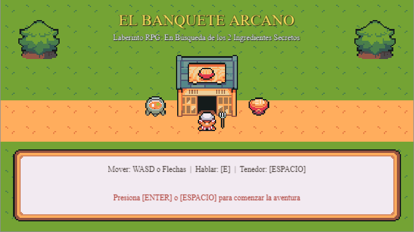
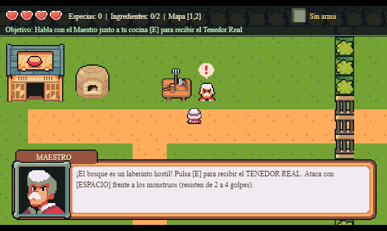
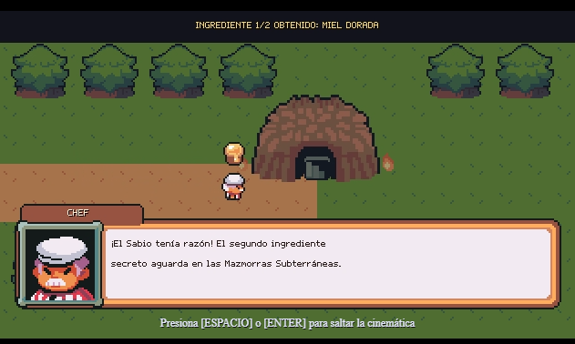
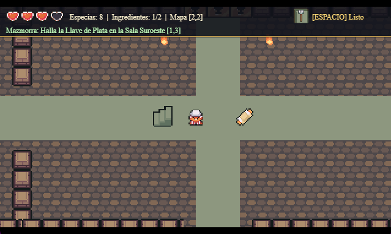

# El Banquete Arcano (Chef Dungeon)

Juego desarrollado en **GDevelop 5** para la actividad *Desarrollando un videojuego* (Módulo 2), TALLER DE PROGRAMACIÓN DE VIDEOJUEGOS - 2620 (B4), IPChile.

Trata sobre un chef que explora un mundo armado como un **mapa tipo laberinto** en busca de **dos ingredientes secretos** (la Miel Dorada y el Camarón Abisal) para cocinar su mejor receta. En el camino conversa con NPCs guía, recoge llaves y enfrenta distintos enemigos usando su tenedor.

**Docente:** Sabina Romero



## Cómo abrirlo

1. Descarga el repositorio (botón **Code** → **Download ZIP**) y descomprímelo completo.
2. En GDevelop 5: **Crear** → **Abrir un proyecto** → **Tu computadora** y selecciona `game.json`.
3. Abre la escena `01_Menu` y presiona **Vista previa**.

## Controles

| Tecla | Acción |
| :--- | :--- |
| `WASD` o `Flechas` | Moverse en 4 direcciones |
| `E` | Hablar con los NPCs (Maestro y Sabio) |
| `Espacio` | Atacar con el Tenedor Real |
| `Enter` o `Espacio` | Comenzar en el menú, reintentar o saltar la cinemática |

## Qué demuestra

- **2 niveles de 9 pantallas cada uno (18 pantallas en total):** tanto el Nivel 1 (Bosque) como el Nivel 2 (Mazmorra) están armados como mapas tipo laberinto en cuadrícula 3x3 (9 pantallas por nivel), con cámara que sigue al jugador e indicador de pantalla actual en el HUD.
- **Avatar jugable (Chef):** movimiento en 4 direcciones, 4 corazones de vida y ataque direccional con el Tenedor Real.
- **NPCs y enemigos con distintos comportamientos:**
  - **Maestro y Sabio (aliados):** personajes guía con diálogo; el Maestro entrega el tenedor al inicio y el Sabio abre la entrada a la mazmorra al llevarle el primer ingrediente.
  - **Slime y Esqueleto (patrulla):** caminan de un lado a otro vigilando los pasillos (resisten 2 golpes).
  - **Hongo y Murciélago (persecución):** esperan quietos y persiguen al chef cuando se acerca (resisten 2 golpes).
  - **Oso Guardián y Demonio Esqueleto (guardianes y jefe):** enemigos más fuertes que cuidan llaves y los ingredientes secretos (resisten de 4 a 5 golpes).
- **Interacción con el entorno:** ingredientes secretos, especias, comida y pociones para recuperar vida, cofres y puertas cerradas con llaves de plata y oro.
- **Sonido:**
  - música distinta para cada escena;
  - pasos diferentes según la superficie (pasto en el bosque y piedra en la mazmorra);
  - efectos de sonido para diálogos, ataques, daño, llaves y objetos recolectados.
- **Estructura:** 6 escenas en total (`01_Menu`, `02_Nivel1_Bosque`, `03_Transicion`, `04_Nivel2_Mazmorra`, `05_Victoria` y `06_GameOver`), donde los 2 niveles jugables cuentan con **9 pantallas cada uno**, unidos por un video MP4 de transición.

| Nivel 1 (Bosque y diálogo) | Transición | Nivel 2 (Mazmorra) |
| :---: | :---: | :---: |
|  |  |  |

## Estructura del repositorio

```text
game.json                           proyecto GDevelop 5 (6 escenas, 2 niveles de 9 pantallas c/u)
assets/characters/                  sprites del chef, NPCs aliados y enemigos
assets/items/                       tenedor, ingredientes, llaves, cofres y curación
assets/tilesets/                    piezas de mapa para el bosque y la mazmorra
assets/ui/                          corazones, barra HUD, cuadros de diálogo y fuentes
assets/audio/                       5 músicas (.ogg) y 14 efectos de sonido (.wav)
assets/video/                       video MP4 de transición entre niveles
docs/                               capturas del juego
LICENSE_ASSETS.txt                  licencia CC0 de los recursos utilizados
```

## Créditos y recursos

Para los gráficos, interfaz y sonidos de este proyecto se ocuparon y adaptaron elementos del paquete de recursos de libre uso **[Ninja Adventure](https://pixel-boy.itch.io/ninja-adventure-asset-pack)** (creado por *Pixel-Boy* y *AAA*), distribuido bajo licencia **CC0 1.0 (Dominio Público)**. Puedes revisar el detalle de la licencia en [`LICENSE_ASSETS.txt`](LICENSE_ASSETS.txt).
